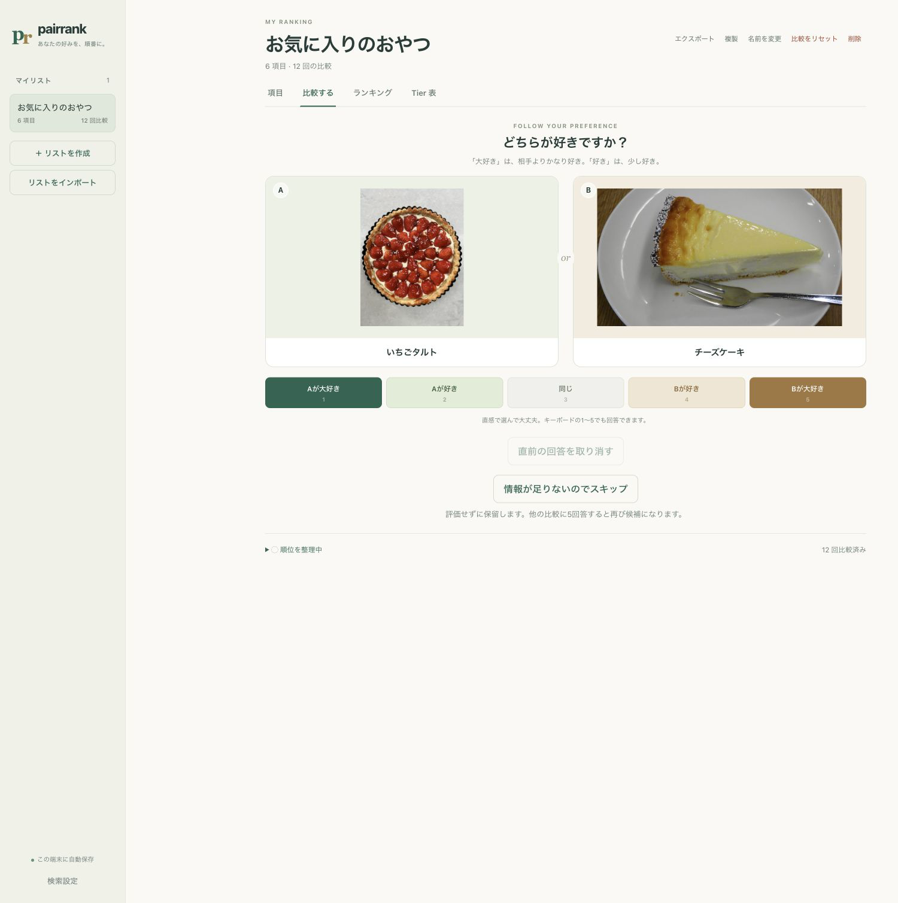
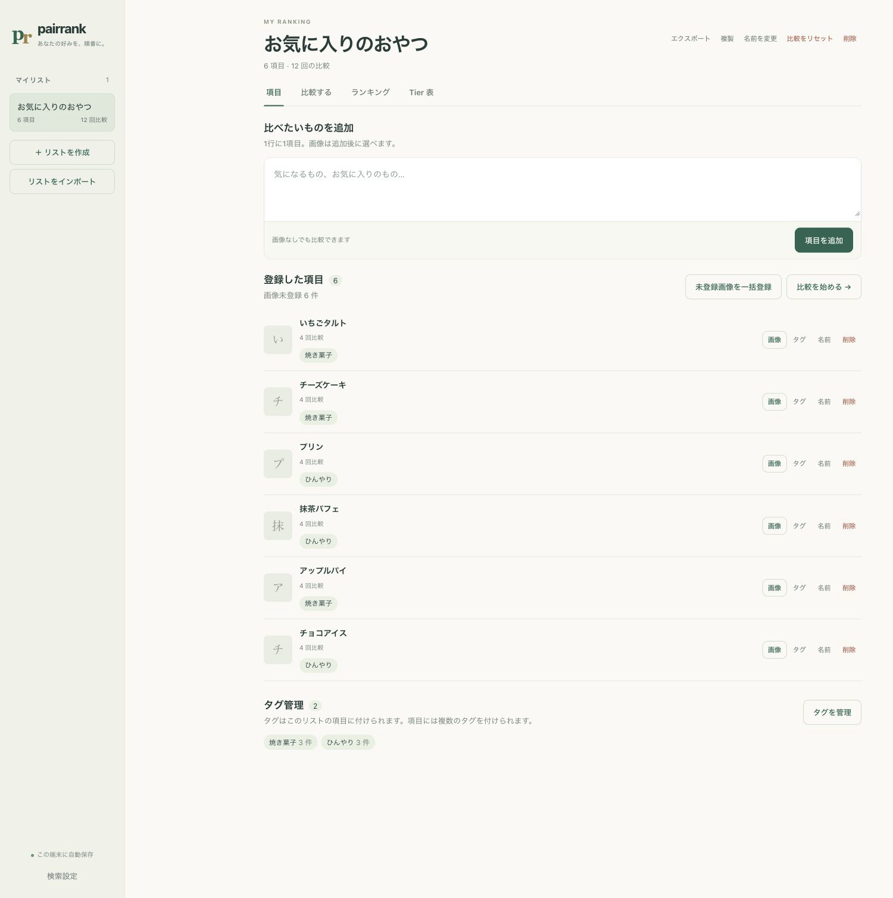
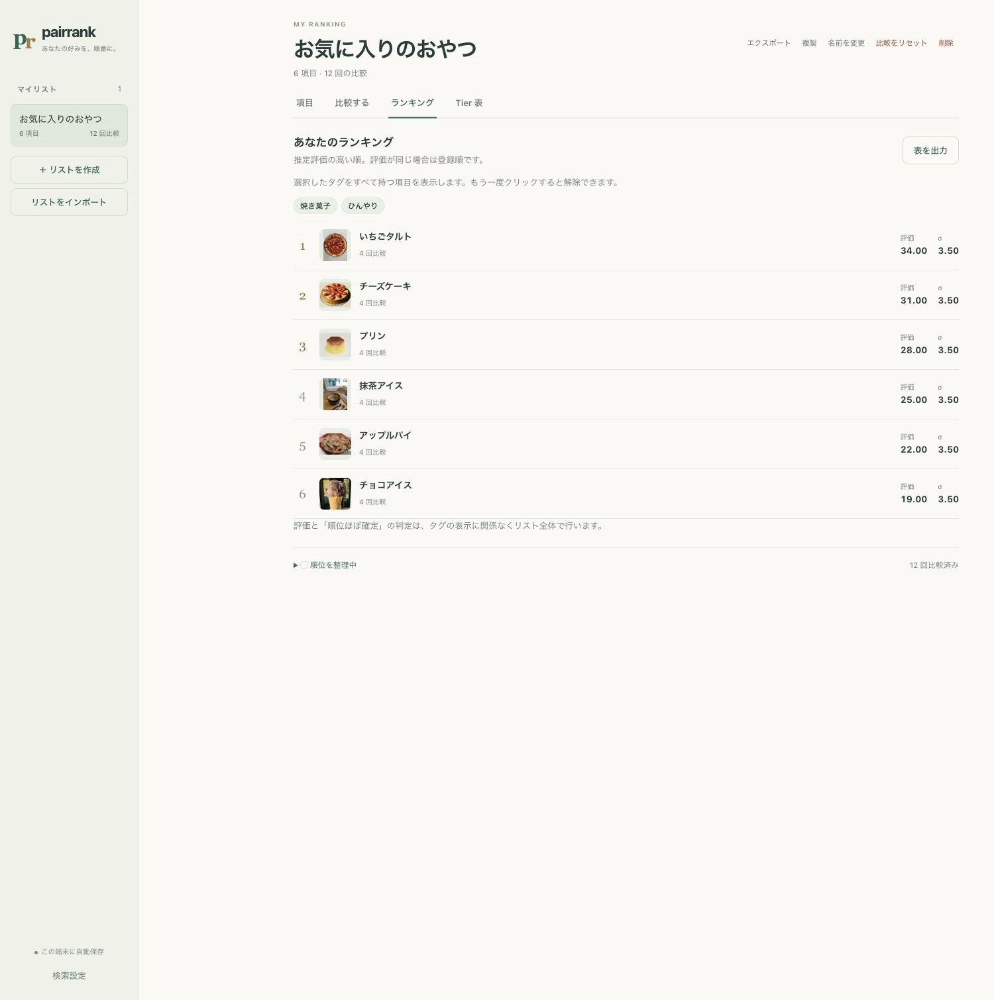
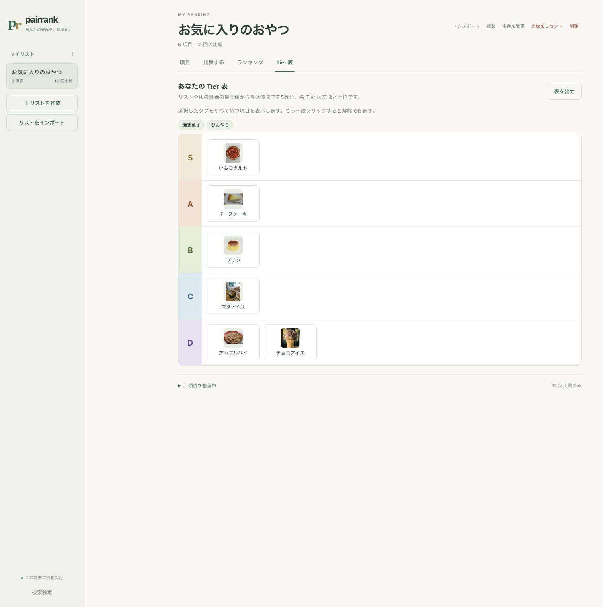

# mizu-pairrank

ふたつの項目を比べて、自分の好みのランキングを作るデスクトップアプリです。
好きな作品や食べ物などを登録し、「どちらが好き？」に答えるだけで、ランキングと Tier 表を作れます。

## ダウンロード

[GitHub Releases](https://github.com/mizucopo/mizu-pairrank/releases) から、お使いのパソコンに合う ZIP をダウンロードして展開してください。

- **Windows**: 通常は `-windows-x64.zip` で終わる ZIP、ARM搭載PCは `-windows-arm64.zip` で終わる ZIP を選び、展開したフォルダー内のアプリ（`.exe`）を起動します。
- **macOS（Apple Silicon）**: `-macos-arm64.zip` で終わる ZIP を選び、展開したアプリ（`.app`）を「アプリケーション」フォルダーに移して起動します。

画像検索の設定は任意です。画像なしでも、手元の画像を登録しても使えます。

## 使い方

### 1. 比べたい項目を登録

リストを作り、項目名を追加します。改行区切りの一括登録に対応し、画像やタグも付けられます。

### 2. ふたつずつ比較

「比較する」を開き、**Aが大好き / Aが好き / 同じ / Bが好き / Bが大好き**から回答します。キーボードの **1〜5** でも操作できます。

判断できないペアはスキップでき、押し間違えたときは直前の回答を取り消せます。

### 3. ランキングを確認

回答を重ねると順位が更新されます。タグで絞り込み、ジャンルごとのランキングも確認できます。「順位ほぼ確定」になった後も、比較を再開できます。

### 4. Tier 表で一覧・出力

評価に応じて **S・A・B・C・D** に自動で分類します。ランキングと Tier 表は PDF／HTML で保存でき、リストの書き出し・取り込みもできます。

画面はサンプルデータを現行アプリのUIで表示した例です。

## 表示言語

サイドバーの「設定」から、日本語・English・システム設定に合わせる、を選べます。
切替はすぐに反映され、次回起動時も保持されます。初期設定は日本語です。
システム設定では優先言語のうち日本語または英語を使用し、どちらもなければ英語になります。
リスト名・項目名・タグ名は変更しません。PDF／HTML の表も選択中の言語で出力します。

## 詳しく知る

- [利用ガイド](docs/user-guide.md): 操作の詳細、画像検索、リストの共有、保存とバックアップ
- [開発・技術情報](docs/development.md): 開発環境、品質チェック、評価・保存・ファイル形式の仕様
- [不具合報告・機能の提案](https://github.com/mizucopo/mizu-pairrank/issues)
